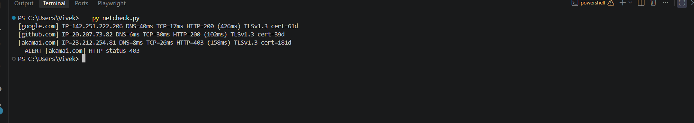

# Network Health Checker

A Python CLI tool that checks DNS resolution, TCP connectivity, HTTP status and TLS certificate expiry for any host, with logging and threshold alerts.

## Features
- DNS resolution time
- TCP connection time (port 443)
- HTTP status code and response time
- TLS version and certificate days remaining
- Alerts for bad HTTP status, slow responses and expiring certificates
- Logging to `netcheck.log`
- Handles failures (timeouts, DNS errors, TLS errors) without crashing

## Tech
Python (socket, ssl, urllib, argparse, logging). No external dependencies.

## Run
```
   python netcheck/netcheck.py
   python netcheck/netcheck.py github.com akamai.com
   python netcheck/netcheck.py --latency 1000 --cert-days 30
```

## Sample Output
```
[github.com] IP=20.207.73.82 DNS=7ms TCP=29ms HTTP=200 (115ms) TLSv1.3 cert=39d
[akamai.com] IP=23.206.173.26 DNS=8ms TCP=25ms HTTP=403 (215ms) TLSv1.3 cert=181d
  ALERT [akamai.com] HTTP status 403

```

## Future Improvements
- Repeat checks on an interval
- Email / Slack alerts
- Scheduled runs with cron
